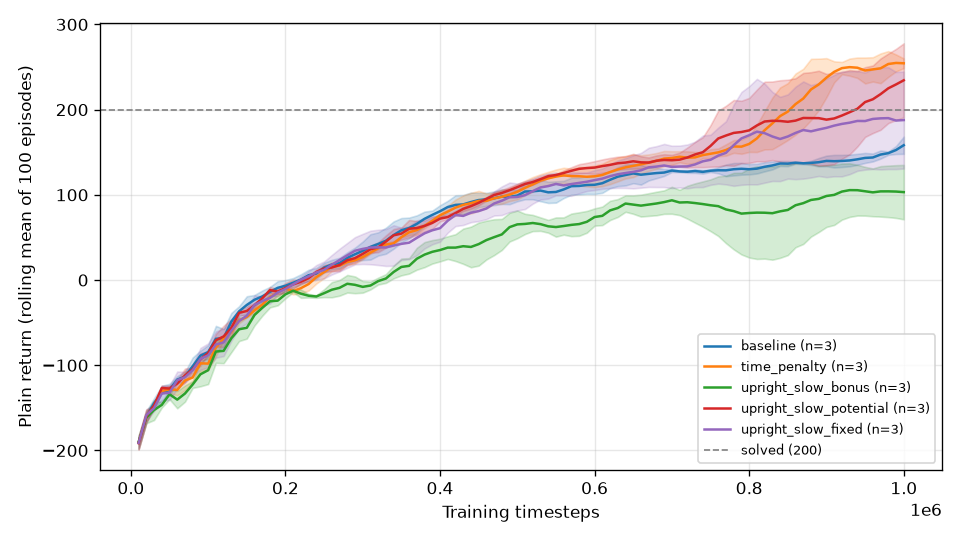
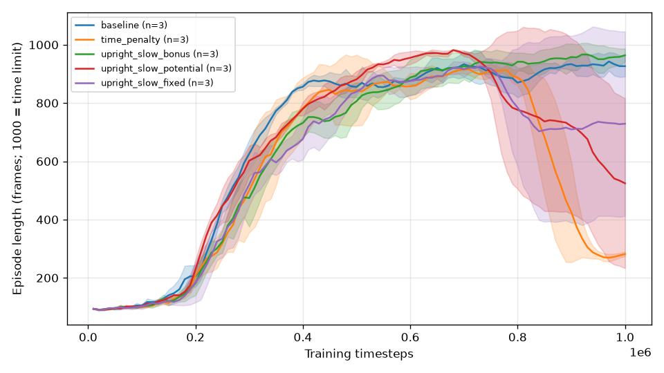
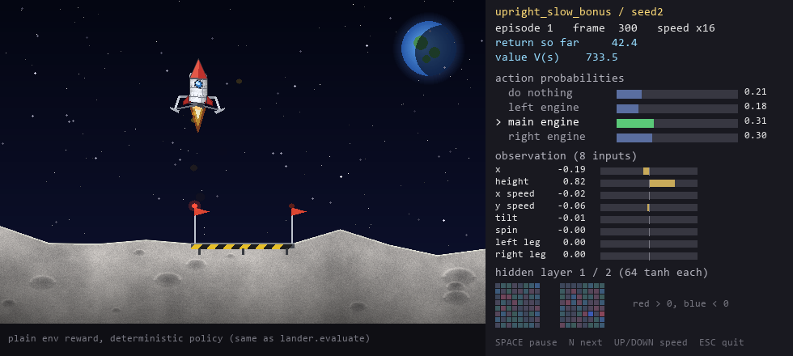
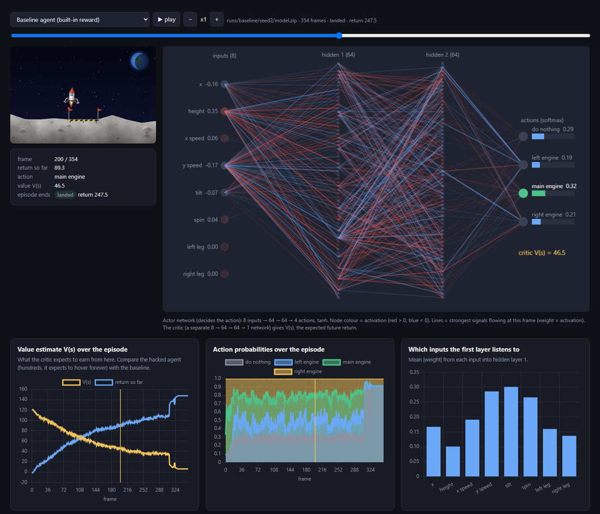
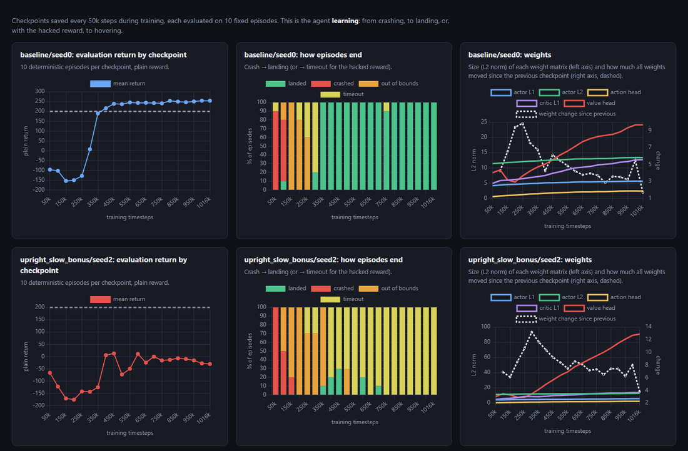

# Reward hacking in Lunar Lander, and how to fix it

A PPO agent learns to land Gymnasium's `LunarLander-v3`. Then I added one innocent-looking reward term,
**"+1 for every frame the lander is upright and slow"**, and the agent stopped landing: it learned to **hover above
the pad until the episode is cut at 1,000 frames**, while its own training score said it was doing brilliantly.
Rewriting the same idea as **potential-based shaping** (Ng, Harada and Russell, 1999) removed the exploit on every seed.

| Hacked reward: hovers until the time limit | Fixed reward: lands |
|---|---|
| [`media/hover_hack.mp4`](media/hover_hack.mp4) | [`media/potential_landing.mp4`](media/potential_landing.mp4) |

Baseline landing: [`media/baseline_landing.mp4`](media/baseline_landing.mp4).

## Results

Every number is an evaluation on the **plain** environment (built-in reward only, custom terms switched off),
with the deterministic policy, over 50 fixed episodes (seeds 10,000 to 10,049), for each of 3 training seeds.
Training: PPO, 1M steps per seed. The return is the mean of the per-seed means, with the worst seed in brackets.

| Reward used for training | Mean return | Success (≥ 200) | Mean length | Hit the 1,000-frame limit |
|---|---|---|---|---|
| `baseline` (built-in only) | 257.3 [252.6] | 98% | 366 | 2% |
| `time_penalty` (−0.05 per frame) | 266.7 [265.8] | 100% | 301 | 0% |
| **`upright_slow_bonus` (+1 per good frame)** | **36.8 [−49.3]** | **19%** | **889** | **77%** |
| `upright_slow_potential` (same idea, potential-based) | 259.9 [255.2] | 100% | 336 | 0% |
| `upright_slow_fixed` (potential + per-frame fee) | 263.4 [249.0] | 100% | 329 | 0% |

With the bonus, two seeds hovered on every episode, and one seed did so on 30% of them. Meanwhile their
**training** reward was about 1,000 per episode. Judged by its own reward, every bonus run "succeeded".




## Why the bonus breaks, and why the fix works

**The loophole.** An episode ends when the lander comes to rest (+100) or crashes (−100), and is cut at 1,000
frames. "+1 per upright and slow frame" pays for *being* in a state. Hovering earns up to about +1 per frame and
costs about 0.18 per frame in fuel here. That is roughly +800 per episode, against about +100 for landing,
which also ends the payments. It gets worse with PPO's discount γ = 0.999 and time-limit bootstrapping. The agent
cannot see a clock, so it values a hovering state at roughly 0.8 / (1 − γ) ≈ 800, wherever it is in the episode.

**The fix.** Pay for *improvement* instead: `F = γ·Φ(s') − Φ(s)`, with `Φ(s) = 10 × uprightness × slowness`.
- Over a whole episode these terms telescope to `γ^T·Φ(s_T) − Φ(s_0)`, which is bounded (at most 10 here).
- Staying in the best state forever earns `(γ − 1)·Φ ≈ −0.01` per frame: nothing to farm.
- Ng et al. proved that this form never changes which policy is optimal. So the honest expectation is
  "baseline-level, but no longer broken", and that is what happened.
- An ablation without the per-frame fee (`upright_slow_potential`) fixes it just as well. The potential term is
  what matters, not the fee.

Three implementation details matter (all covered by tests in [`tests/test_rewards.py`](tests/test_rewards.py)):
1. The shaping γ must equal PPO's γ.
2. Φ is set to 0 on a real termination, but not on a time-limit truncation.
3. Φ is recomputed on every reset.

## What I learned
- **The training curve can lie.** The hacked agents' shaped return rose to about 1,000 while the true score fell.
  Only an evaluation on the plain reward, the truncation rate and the video showed the truth.
- **The exploit found depends on the learning path.** I predicted the agent would land and then twitch a side engine
  to stay "awake": it is cheaper, and I confirmed the mechanism in the physics code. Two seeds hovered anyway. Hovering
  is reachable before the agent knows how to land, and it already paid ten times more than landing.
- **The same mechanism shows up without any hack.** During training, the *baseline* hits the time limit on 89% of
  episodes. Its stochastic policy lands, then random side-engine firings keep the body awake, so the episode never
  ends. The deterministic policy lands in 366 frames. Training-time truncation is therefore not a hack signature on
  its own. That finding is why the evaluation protocol fixes the policy to deterministic and the reward to plain.
- **Small, boring infrastructure decides whether results are trustworthy.** Examples: logging the plain return
  next to the shaped one, 3 seeds per variant, writing the hypothesis before each run
  ([`docs/EXPERIMENTS.md`](docs/EXPERIMENTS.md)), and recording versions and the git hash in every run's `config.json`.

## See it: two interfaces
Both need trained models in `runs/` (train them as below; models are not committed).

**1. The lander, live** (`python -m lander.watch`): a game window, with what the network sees and decides next to it.
```bash
python -m lander.watch --random                                        # untrained agent: tumbles and crashes
python -m lander.watch --progression runs/progression/baseline/seed0   # one flight per checkpoint: crash -> landing
python -m lander.watch --model runs/upright_slow_bonus/seed2           # the hacked agent hovering
python -m lander.watch --compare                                       # random, baseline, hack, fix in turn
```
Keys: SPACE pause, N next, UP/DOWN speed, ESC quit. Graphics: a textured moon and a rocket-shaped lander
drawn by `lander/scene.py` from the physics state (purely cosmetic: a test checks that observations and
rewards are identical with and without it). `--classic` shows Gymnasium's original flat drawing. Progression runs are trained with
`--checkpoint-every 50000 --run-dir runs/progression/<reward>/seed<N>`.



The panel shows the critic's estimate V(s). It stays around 735 while the hacked agent hovers; the baseline, during its descent, is around 50.
The network has learned that hovering is worth a fortune.

**2. The machine-learning dashboard** (`python -m lander.dashboard`): a local web page with:
- results;
- training curves, and shaped versus plain return;
- learning progression by checkpoint;
- a frame-by-frame replay of the actor network next to the video;
- weights and the test suite.




The progression panel shows the hack *taking over*. With the bonus, seed 2 first learns to land (up to 30% of
episodes around 400k to 650k steps), then unlearns it and hovers on every episode.

## Reproduce one result (about 10 minutes on a laptop CPU)
Requires Python **3.12.1 or later** in the 3.12 line. 3.12.0 has a `zipfile` bug that breaks loading saved models.
```bash
py -3.12 -m venv .venv && .venv/Scripts/activate        # Linux/macOS: python3.12 -m venv .venv && . .venv/bin/activate
pip install -r requirements.txt && pip install -e .
python -m lander.train --reward upright_slow_bonus --seed 1 --vec dummy --torch-threads 1
python -m lander.evaluate runs/upright_slow_bonus/seed1    # expect: trunc=100%, success=0%
python -m lander.record runs/upright_slow_bonus/seed1 --out media/my_hover.mp4
```
On the original machine a fresh clone reproduced this run exactly (-49.3 +/- 32.2, 100% truncation).
Across machines expect the same ballpark; bit-identical numbers are not guaranteed.

## Project layout
```
src/lander/  envs.py (env + Monitor + reward wrapper), rewards.py (reward variants), train.py,
             evaluate.py (plain env, deterministic, 50 fixed seeds), record.py, plots.py,
             watch.py (live viewer), scene.py (textured renderer), dashboard.py + dashboard_template.html,
             introspect.py (network internals)
tests/       wrapper pass-through, shaping math, potential telescoping, evaluation metrics, introspection, renderer (39 tests)
docs/        DESIGN.md (design + critical review), PLAN.md, EXPERIMENTS.md (dated log of every run)
```
Stack: Python 3.12, Gymnasium 1.3 (Box2D), Stable-Baselines3 2.9 (PPO, `MlpPolicy` 2×64), PyTorch 2.14 on CPU.
PPO hyperparameters are the Hugging Face Deep RL course defaults and were not tuned.

## Roles
I specified the project, reviewed the design and the results, and validated them. The code was written with Claude Code.
Based on an idea by Hari (@harixganesh), "Training an AI to land a rocket with reward shaping".
